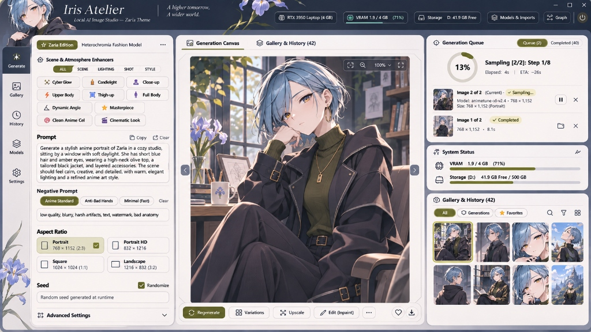

# 🌸 Iris Atelier — Local AI Image Studio

<p align="center">
  <em>"A higher tomorrow, A wider world."</em>
</p>

<p align="center">
  
  
  
  
  
</p>

---



**Iris Atelier** is an elegant, high-performance local AI image generation studio engineered specifically to run smoothly on budget hardware (such as laptops with **4 GB VRAM GPUs** like the NVIDIA RTX 3050). 

It connects a sleek 3-column React dashboard to a headless ComfyUI backend through an asynchronous FastAPI gateway, featuring atomic sequential batch processing, live WebSocket progress rings, curated anime archetype templates, and a complete gallery management suite.

---

## ✨ Key Features

### 🎛️ 1. Multiprompt Generation Mode (Safe Sequential Queue)
- **Sequential Prompt Slots**: Enter up to **10 distinct prompts** (Prompt A through Prompt J / 1 to 10) in sequential slots.
- **Single-Runner Atomic Execution**: Jobs are queued and rendered strictly one-by-one through ComfyUI. This prevents concurrent model allocations and eliminates VRAM spikes, Out-Of-Memory (OOM) crashes, and memory leaks.
- **One-Click Character Batching**: Click **"Load 5 Characters"** to instantly fill slots with Zaria, Nixia, Angela, Virelia, and Vivianne for continuous queued batch creation.

### 🎨 2. Iris Atelier UI (Zaria Theme)
- **3-Column Studio Dashboard**:
  - **Left Dock**: Quick navigation bar with atelier emblem and shortcut triggers.
  - **Left Column**: Character archetype badges, mode switcher, atmosphere tag chips (☕ Cozy Cafe, 🌧️ Neon Rain, 🌸 Sakura, etc.), 2×2 visual aspect ratio cards, dice randomizer, and collapsible advanced parameters.
  - **Center Column**: Framed image canvas with live radial progress ring, zoom toggles (`Fit` vs `100%`), chevrons (`<` and `>`) for cycling through generation history, and bottom action bar (`Regenerate`, `Variations`, `Reuse Settings`, `Favorite`, `Download`).
  - **Right Column**: Live Generation Queue card with elapsed time and prompt queue preview, real-time hardware telemetry (GPU VRAM meter and disk storage gauge), and mini-gallery thumbnail ring.
- **Typography & Aesthetics**: Paired serif typography (*Cormorant Garamond*) with modern sans (*Plus Jakarta Sans*), deep slate palette (`#151821`), iris accents (`#8699b8`), and moss green primary actions (`#4d6b53`).

### 🎭 3. Curated Archetype Templates (Spaced-Out Multiline Structure)
Five character archetypes pre-configured with modular paragraph spacing (Quality/Vibe, Hair & Eyes, Outfit, and Background) for effortless prompt editing:
1. **Zaria**: Heterochromia fashion model with asymmetrical cyan crop cut, olive green halter crop top, and oversized black jacket.
2. **Nixia**: Petite gothic mesugaki with silver hair, purple highlights, twin buns, crimson eyes, and gothic corset.
3. **Angela**: Curvy secretary with light blue messy bob, amber eyes, and white lab coat.
4. **Virelia**: Gentle maid with pastel pink twin-tied hair, golden eyes, freckles, and pink collared apron dress.
5. **Vivianne**: Tall kuudere with silver-white ankle-length hair, red eyes, and oversized black sweater.

### 📦 4. Integrated Model Importer & Downloader
- **Direct Web Downloader**: Download checkpoint or GGUF models directly from CivitAI or Hugging Face in the background with real-time download speed meters.
- **Local Scanner**: One-click scanning of your Windows `Downloads` directory to import `.safetensors` and `.gguf` files into ComfyUI models storage.
- **GGUF Quantization Support**: Optimized for ultra-fast 6-bit and 8-bit quantized UNet diffusion (such as Anima Turbo Q5_K_M).

### 🗃️ 5. Albums Categorization & Gallery Suite (500+ Cap)
- **Non-Destructive Albums**: Select any number of images (`A B C D...`) and click **"Add to Album"** or **"Create New Album"**. Categorized images are indexed safely in SQLite many-to-many tables and always remain intact in your main archive.
- **Album Filtering & Management**: Browse individual albums with dedicated filter pills and badge counts. Remove images from an album or delete albums without touching the underlying image files.
- **500+ Image Archive Scale**: Gallery capacity expanded beyond the default 50-image threshold, allowing smooth browsing of expansive render histories and burst archives.
- **Keyboard Arrow Shuffling (`<` and `>`)**: Seamlessly shuffle between renders using the keyboard `<` / `,` (Previous) and `>` / `.` (Next) or Left `◄` / Right `►` arrow keys. Automatically avoids interrupting active text inputs or prompt editing.
- **Multi-Select & Bulk Actions**: Select all or individual images with visual checkboxes.
- **1-Click ZIP Export**: Download selected renders as a single compressed `.zip` archive.
- **Permanent Batch Delete**: Bulk delete unwanted renders from disk and SQLite in one click to reclaim storage.

### 📸 6. Angle & Pose Matrix (10, 50, 100 Burst)
- **Disguised Quick Action Trigger**: A sleek camera icon integrated directly alongside the main Generate button with live status indicator.
- **Pure Angles & Poses (Zero-Place Interference)**: Injects 100 curated camera perspectives, framing angles, and physical postures (squatting, seiza kneeling, lying on stomach, Dutch tilts, worm's-eye, bird's-eye) without any location or furniture conflicts—preserving your exact character and background prompts.
- **Configurable Burst Counts**: Choose between **10 Shots** (Quick Preview), **50 Shots** (Extended Reel), or **100 Shots** (Master Matrix).
- **Automated Album Grouping**: Automatically creates and links an album (e.g., `Zaria - 100 Angles`) while simultaneously keeping every render available in the normal atelier gallery.
- **VRAM Hardware Safety**: Sequentially queues all jobs through the single-runner queue, preventing OOM crashes on 4GB VRAM hardware.

### 📜 7. JSON to Generate (Batch Preset Runner)
- **Import & Detect**: Import any `.json` file or paste JSON definitions. The system automatically detects the number of generations, validates prompt integrity, and displays a card preview for each queued item.
- **Downloadable Template**: 1-click download of `iris_batch_template.json` pre-configured with curated character prompts and parameter overrides.
- **Flexible Schema with Shared Defaults**: Define global defaults (`model`, `steps`, `cfg`, `dimensions`, `sampler`) and easily override individual items with custom aspect ratios, seeds, or prompts.
- **Album Integration**: Automatically groups the imported batch into an album (e.g., `Atelier Concept Showcase`) while preserving full availability in the main gallery.
- **Queue Protection**: Executes sequentially through the single-runner engine without VRAM spikes on 4GB GPUs.

---

## 🏗️ Architecture

```
┌────────────────────────────────────────────────────────┐
│               Iris Atelier Web Frontend                │
│       React 19 + Vite + TypeScript + Tailwind CSS      │
└───────────────────────────┬────────────────────────────┘
                            │ HTTP & WebSockets
                            ▼
┌────────────────────────────────────────────────────────┐
│                 FastAPI Backend Service                │
│   • Asynchronous Safe Single-Runner Queue              │
│   • Live Telemetry Monitor (GPU VRAM & Disk Storage)   │
│   • SQLite Database (Gallery & Characters CRUD)        │
│   • CivitAI / Hugging Face Downloader                  │
└───────────────────────────┬────────────────────────────┘
                            │ JSON API Workflows
                            ▼
┌────────────────────────────────────────────────────────┐
│             ComfyUI Headless Engine (8188)             │
│   • Anima Turbo GGUF / SDXL Checkpoints                │
│   • Low-VRAM Execution Mode (--lowvram)                │
└────────────────────────────────────────────────────────┘
```

---

## 🚀 Getting Started

### Prerequisites
- **OS**: Windows 10 / 11 (or Linux)
- **GPU**: NVIDIA GPU with at least 4 GB VRAM (RTX 3050, GTX 1650, or higher)
- **Software**:
  - Python 3.10+
  - Node.js 18+ & npm
  - [ComfyUI](https://github.com/comfyanonymous/ComfyUI)

### Installation

1. **Clone the repository**:
   ```bash
   git clone https://github.com/HugoIrfenz/iris-atelier.git
   cd iris-atelier
   ```

2. **Install Python backend dependencies**:
   ```bash
   pip install -r requirements.txt
   ```

3. **Install and build frontend**:
   ```bash
   cd web
   npm install
   npm run build
   cd ..
   ```

4. **Launch ComfyUI** (with low-VRAM optimizations):
   ```bash
   python main.py --port 8188 --listen 127.0.0.1 --lowvram
   ```

5. **Start Iris Atelier**:
   ```bash
   cd backend
   python -m uvicorn main:app --host 127.0.0.1 --port 7860
   ```
   Or simply execute `start_studio.bat` on Windows.

6. **Open in Browser**:
   Navigate to **`http://127.0.0.1:7860`**.

---

## 📁 Repository Structure

```
iris-atelier/
├── backend/
│   ├── main.py              # FastAPI application & sequential queue worker
│   ├── database.py          # SQLite persistence & character presets
│   └── downloader.py        # Background model downloader
├── web/
│   ├── src/
│   │   ├── App.tsx          # Complete Iris Atelier 3-column dashboard
│   │   └── main.tsx         # Entry point
│   ├── index.html           # Atelier theme & Google Fonts
│   ├── package.json
│   ├── tsconfig.json
│   └── vite.config.ts
├── workflows/
│   ├── anima_turbo_api.json # ComfyUI GGUF API workflow template
│   ├── checkpoint_api.json  # ComfyUI SDXL checkpoint API workflow
│   └── pulid_api.json       # PuLID / InsightFace workflow
├── docs/
│   └── screenshots/
│       └── iris_atelier_dashboard.jpg
├── start_studio.bat         # 1-click launch batch script
├── start_studio.ps1         # PowerShell launcher
├── stop_studio.bat          # 1-click shutdown script
├── requirements.txt         # Python dependencies
└── README.md
```

---

## 📄 License
This project is licensed under the [MIT License](LICENSE).

---

<p align="center">
  Crafted with care by <b>Hugo Irfenz</b> (<code>@HugoIrfenz</code>).
</p>
